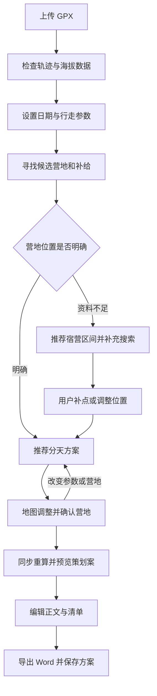

# 个人版路线策划案生成器设计规格

本工具帮助用户把两步路导出的 GPX 路线转成重装露营策划案。用户设置本次出行参数，系统分析轨迹、推荐分天和营地；用户调整并确认后，导出可编辑 Word。全国路线使用同一套分析流程，营地资料不足时通过资料搜索和用户补点继续规划。

推荐采用本机运行的服务和浏览器操作界面。开发先完成 GPX 到 Word 的基础流程，再接入小红书、抖音等资料来源，最后完善装备、饮食、天气和交通内容。各平台的实际可用权限与内容使用范围决定对应采集能力的上线范围。

## 1 已确认需求与设计假设

### 已确认需求

- 个人使用，支持全国路线，输入为两步路导出的 GPX。
- 第一版以重装露营为主要活动方式。
- 系统推荐分天和营地，用户可以调整，确认后生成策划案。
- 内置资料采集模块，在营地资料不足时搜索小红书、抖音等平台补充。
- Word 输出参照现有策划案的栏目、每日行程表和路线图结构。

### 本规格采用的设计假设

- 使用当前 Windows 电脑，本机保存原始文件、个人参数、计划和导出的文档。
- 默认按每日行走上限推荐总天数，也允许指定总天数。每日行走上限与每日包含休息的总耗时分别计算。
- 联网搜索和 AI 整理可调用外部服务；路线计算、方案保存和文档导出在本机完成。
- 工具由个人使用，活动可以有多名队员；队伍人数和分工单独填写。
- 首版支持在工具内编辑后导出，并允许在 Word 中继续编辑。Word 中的修改自动回传到工具属于后续扩展。

本机运行不等于完全离线。界面应说明当前操作需要的网络服务，以及发送的路线地名或资料文本。

## 2 个人版实现方式比较

| 方式 | 优点 | 主要代价 | 适用判断 |
| --- | --- | --- | --- |
| 本机服务加浏览器界面 | 便于上传文件、查看地图、调整营地和预览文档，数据可保存在本机 | 需要启动服务，并处理联网服务的凭证 | 推荐用于第一版 |
| 命令行脚本 | 容易先验证轨迹计算和文档生成 | 地图调整和人工核对不方便 | 适合内部验证工具 |
| 完整桌面应用 | 可统一启动、安装和文件管理体验 | 增加打包、升级和桌面适配工作 | 基础流程稳定后再评估 |

本机服务默认只接受本机访问。个人参数、路线计算、资料采集和文档输出分别保留清晰接口，便于后续改成桌面应用。

## 3 用户工作流程

### 3.1 上传并检查路线

读取 GPX 的轨迹点、分段和标记点，显示起终点、方向、距离、海拔曲线和数据完整性。保留原文件，记录清洗与高程处理方式。

遇到多条轨迹、多段轨迹、断点或异常跳跃，列出受影响的位置供用户选择或处理。断点连接需要明确路径，不能直接把两点之间的直线当作可走路线。缺失海拔显示为未知；补高程时记录来源和处理版本。

GPX 标准允许海拔、时间和标记点，但它们不一定出现在实际文件中。历史记录时间用于理解原轨迹，不作为新活动的出发日期或预计配速。[GPX 1.1 规范](https://www.topografix.com/gpx/1/1/)

### 3.2 设置本次活动与个人参数

首次设置队伍配速或经验档位、预计负重、每日行走上限、通常出发时间、休息与扎营预留。可保存多套配置，例如双人重装和多人重装。

每次确认路线方向、出发日期、人数和本次采用的参数；目标总天数为可选项。默认活动方式为重装露营。系统展示采用的估算参数，用户可以修改，不把假定体能隐藏在推荐结果里。

### 3.3 查找营地与补给资料

先读取文件内的标记和个人已有地点，再沿路线及附近地名查找可用地图资料、公开攻略和已接入的社交平台内容。检索记录实际查询、返回结果和失败原因。

对于每条资料，提取地点线索、实际旅行日期、营地条件、补水与开放信息，并保留可使用的来源链接和证据。只知道大致地区的内容保留为待定位线索。

### 3.4 推荐分天方案

候选营地位置明确后，结合每日完整路径、升降、配速、负重、休息、日照和营地连接路径，推荐默认方案。有其他可行安排时提供备选；没有满足约束的方案时展示具体冲突。

每个方案展示总天数、每日距离、累计上升下降、估算行走时间、休息时间、到营时间和超限原因。资料不足的路段可以展示按负荷推导的宿营区间，具体营地由用户补点确认。

### 3.5 地图调整与营地确认

用户可以新增、移动、替换或删除营地和检查点，修改配速、负重、每日上限及目标天数。点击营地可查看地图位置、定位依据、来源日期、补水、限制和资料冲突。

营地的“采用到计划”与资料的“已核实”分别记录。选择使用一个地点不等于所有营地条件都已核实。已定位候选可以参与方案预览；导出确认方案的每日宿营点需要用户确认采用，未完成的选择仍可随项目保存。

用户可以锁定采用的营地。再次推荐时保留锁定选择，发生约束冲突则提示原因，由用户选择修改参数或解除锁定。

### 3.6 同步重算与内容预览

改变轨迹、方向、营地、连接路径或行走参数后，重算受影响的分段、行走时间、日期、每日地图和行程表。天数改变时，同步更新关联的餐次和按人数天数计算的数量。

计算结果采用统一版本。正文预览与地图使用同一份计划数据，避免新营地配旧行程表。用户编写的备注、描述和自定义地点保留；自动字段与手工正文分别保存。

### 3.7 编辑并导出 Word

预览区域介绍、天气、交通、队员分工、营地补给、每日行程表、路线图、下撤、装备、饮食、医疗用品、风险提示及声明。允许修改正文和清单。

未取得可靠资料的字段显示为待补或待核实。医疗用品和声明采用用户认可的模板，原样例的药品、天气、交通和风险数字不作为全国路线的通用规则。

导出时校验日期、编号、距离和升降合计、时间累计、选定营地及数据版本。保存完整方案和导出记录，用户可以重新打开、补充资料并再次导出。各阶段的未完成项目也可保存；未完成关键营地选择时，允许导出明确标注状态的草稿。

## 4 系统模块与数据交接

| 模块 | 接收 | 产出 | 独立责任 |
| --- | --- | --- | --- |
| 路线处理 | GPX 和处理配置 | 标准化轨迹、分段统计、完整性问题 | 解析、距离、高程和方向处理 |
| 资料采集 | 地区、路线别名、附近地名和查询任务 | 带来源的地点线索或采集状态 | 各平台检索、内容读取及可用字段映射 |
| 地点与证据管理 | 地点线索、地图匹配结果和用户补点 | 营地、补给和逐字段证据 | 定位、去重、时效、冲突和采用状态 |
| 分天计算 | 路线、已定位营地、连接路径和活动参数 | 每日计划、估算值和约束冲突 | 路径分段、时间估算、方案比较和重算 |
| 文档生成 | 同一版本的每日计划、正文和清单 | 预览、可编辑 Word 和校验结果 | 填充模板、生成地图和排版 |
| 本地保存 | 各模块的成果与用户修改 | 可恢复的项目与版本记录 | 保存、恢复、备份和资料刷新记录 |

资料采集失败返回失败状态和已有结果，基础规划继续使用用户补点或已有资料。AI 负责资料整理和文字说明；路线指标、约束判断与合计由计算模块产生。

## 5 必须分别保存的数据和状态

- **路线**：原文件、轨迹分段、方向、海拔完整性、处理版本，以及源轨迹统计。
- **活动参数**：日期、人数、队伍档位、负重、每日行走上限、出发时间、休息和扎营预留、可选目标天数。
- **地点**：名称、坐标、轨迹上的对应位置、连接路径、定位依据与定位状态。
- **证据**：来源链接、实际旅行日期、发布日期、检索日期、可使用的证据内容、字段结论、转载关联和内容使用范围。
- **采用状态**：候选、采用、排除；与已核实、待核实、冲突等证据状态分别保存。
- **每日计划**：完整行走路径、宿营点、检查点、升降、估算时间、休息、到营时间和超限原因。
- **文档内容**：派生字段、用户正文、清单模板、手工改动和导出版本。

证据不足使用可理解的状态说明，不采用未经校准的可靠性百分比。水源字段可分别记录“有水源线索”“饮用属性待核实”“供水情况待核实”等结论，避免把一个笼统的水点标签写成确定可饮用。

## 6 分天计算与调整规则

1. 源轨迹总里程与计划实际行走里程分别显示。营地连接、返回主线和其他确认绕行计入计划路径，日合计对应计划总量。
2. 行走时间按完整路径估算，已包含连接和绕行；总耗时再加休息与补给停留，避免重复计入。扎营预留参与到营时刻的约束判断。
3. 使用完整海拔时，对升降计算记录平滑方式；缺失海拔时，相应指标和估算依据明确标注。
4. 默认按每日上限和候选宿营点推荐总天数。指定天数发生冲突时，说明哪一天超限以及原因，提供增加天数或修改参数的方案。
5. 只有大致区域的营地线索不能成为精确日界。用户补点后再计算实际边界。
6. 路线外营地需要明确的连接路径。连接未知时标明相关距离和用时未确定，不以直线距离填入确定值。
7. 同一个营地或参数调整触发所有相关结果更新，保留手工正文，记录变化和新的冲突。
8. 推荐结果展示估算参数和依据。预计到达时间用于方案比较，不能当作实走保证。

## 7 内置资料采集的工作流程

### 搜索与提取

搜索任务按路线覆盖区域、附近村落和山口生成关键词，优先补充计划中缺少营地或补给依据的路段。第一阶段处理可获得且允许使用的文字和图片信息；视频字幕、语音和画面文字在取得相应读取与处理范围后加入。

提取结果需要对应具体证据，区分作者实际出行日期、帖子发布日期和本次检索日期。重复发布、转载或复制同一内容合并为同一来源线索，多篇转载不算多次独立验证。

### 定位与冲突处理

地名匹配要考虑同名地点、路线别名和轨迹位置，视频拍摄位置不自动等于营地位置。地图上的平地和附近水源只能帮助寻找候选地点，不能单独证明当前可以露营、能到达或有可靠饮水。

出现相反信息时，保留两边证据，检查是否为同地点、不同旅行日期或不同季节。当前官方或经营方信息优先用于开放条件判断，其他内容保留为补充。无法解决的冲突标为待核实。

### 各平台接入验证

抖音官方提供视频、图文搜索的申请入口，产品页仍要求申请内测和审批。其搜索规范对资源爬取、存储、缓存和下载有约束，接入时分别确认搜索展示、模型处理、信息抽取、摘要留存及 Word 输出的使用范围。[抖音搜索能力](https://developer.open-douyin.com/product/search) [抖音搜索使用规范](https://developer.open-douyin.com/docs/resource/zh-CN/dop/ability/search-management/item-search)

小红书官方智能体介绍提到笔记库和笔记检索能力。该能力是否能用于独立的个人工具、有哪些可调用字段和内容使用范围，应以实际可接入的服务及规则验证。[小红书智能体介绍](https://miniapp.xiaohongshu.com/doc/DC897827)

每个来源在启用前应完成：权限可用测试、查询与分页测试、字段映射、内容使用范围记录、访问失败与限流恢复测试。个人使用版仍需验证这些条件。

### 失败时继续规划

未获权限、结果不足或内容无法读取时，保留已完成的轨迹分析和方案，允许换资料来源、提供可用分享内容、输入描述或直接标营地。任务记录“失败”“部分完成”或“暂无结果”，避免把未访问成功写成已完成全部检索。

## 8 Word 模板与栏目

模板参考现有[麦理浩径行程计划书](<D:/软件/xwechat_files/wxid_kpuqqynnkyj022_9849/msg/file/2026-09/25.12.30麦理浩径行程计划书V5(4).docx>)的栏目和表格结构，参考文件保持只读。

| 栏目 | 第一版内容生成方式 |
| --- | --- |
| 区域介绍 | 根据可用资料整理，正文可编辑 |
| 天气与交通 | 按日期和地点查询；缺失时保留待补字段 |
| 队员与职责 | 个人配置和本次填写 |
| 营地与补给 | 选定地点和逐字段证据，保留待核实项 |
| 每日行程表 | 统一计划数据生成检查点、距离、升降、时间和休息 |
| 路线图与海拔图 | 总图和按日地图，依据当前路线版本生成 |
| 下撤说明 | 可用资料与用户确认的地点路径；不足时待补 |
| 装备与饮食 | 用户模板，按人数天数计算可确定数量，并允许手改 |
| 医疗用品与声明 | 用户认可的模板，允许逐项编辑 |
| 风险提示 | 根据具体路线条件和资料整理，数字评分需有明确规则 |

基础流程先完成整套栏目、计算字段、地图和可编辑输出；资料增强逐步增加各栏目的自动填充程度。

## 9 开发拆分与交付顺序

### 子项目 A 基础规划和文档输出

这是第一个独立交付：用户可以上传全国 GPX、手动标营地、得到分天方案并导出 Word。

| 阶段 | 工作 | 可检查的交付结果 |
| --- | --- | --- |
| A1 | 用真实 GPX 验证字段，设计个人参数和数据结构 | 路线预览、完整性问题、个人配置可保存 |
| A2 | 加入手动营地、连接路径、每日上限及指定天数规划 | 可调整的每日方案，超限原因明确，修改后同步重算 |
| A3 | 加入样例栏目、每日地图、正文编辑、Word 导出和本地恢复 | 一份能重新打开和修改的完整策划案项目，以及可编辑 Word |

### 子项目 B 营地资料采集与证据管理

子项目 B 接收路线查询任务，输出地点线索和证据，使用固定样例即可独立验收。平台接入验证可以与子项目 A 并行进行；集成采集结果前，以 A 的地点和计划接口为准。

| 阶段 | 工作 | 可检查的交付结果 |
| --- | --- | --- |
| B1 | 定义来源适配接口，接入可用资料和用户提供内容 | 可重复的查询样例、字段映射、来源与失败状态 |
| B2 | 加入定位、转载去重、日期判断、冲突和证据卡 | 用户可检查地点依据，并选择采用、调整或排除 |
| B3 | 接入实际通过验证的小红书或抖音能力 | 许可范围内的真实检索结果可进入营地候选，失败不阻断 A |

### 子项目 C 内容完善和使用体验

在基础流程和资料接口稳定后，完善按日期检索的天气交通、装备饮食模板、下撤资料、个人地点复用和项目备份。对不同地区和数据质量的路线进行端到端检查，形成第一版个人工具。

平台审批与真实资料覆盖属于外部依赖。安排工期时，分别估计基础开发、接入验证和接入等待，不把等待时间隐含在统一交付承诺里。

## 10 验收标准

1. **轨迹可追溯**：保留原文件，异常轨迹和缺失海拔可见，统计处理有记录。
2. **每日路径完整**：日路径覆盖计划采用的主线和营地连接；断点与未知连接有明确状态。
3. **数量一致**：每日距离和升降与同版本计划合计一致；源轨迹统计与计划统计分别显示，内部合计使用未四舍五入的数值。
4. **约束明确**：推荐总天数遵循每日上限；指定天数冲突显示原因，不默默放宽参数。
5. **修改同步**：移动营地、改方向或参数后，日期、地图、分段指标和到达时间一起更新；再次推荐保留锁定选择，冲突时提示用户处理。
6. **资料可检查**：候选地点有来源或用户补点依据，定位、核实和采用状态独立；转载和冲突得到保留处理。
7. **采集失败可恢复**：两个社交平台均不可用时，仍能通过已有资料和用户补点完成基础策划案。
8. **编辑可保留**：重新计算和导出保留用户正文、备注和自定义地点；导出失败不丢失计划。
9. **Word 可使用**：文档可编辑，日期编号与当前计划相符，地图表格无溢出，待核实内容有清晰标识。
10. **保存可恢复**：关闭工具后重新打开项目，可恢复所用轨迹、参数、营地、证据、正文和导出版本。

验证路线至少覆盖：海拔完整、海拔缺失、多段或断点、营地偏离主线、资料不足及平台关闭、指定天数冲突、营地修改后重新导出。全国覆盖的验证使用多个地区的真实路线，但不把有限样本通过写成所有路线均已验证。

## 11 进入实施规划的条件

设计规格确认后，先为子项目 A 编写逐任务实施计划，明确拟创建的文件、模块接口、测试输入、通过标准和任务顺序。子项目 B 的接入验证结果随接口设计整理，作为后续独立计划的依据。

首个基础验证使用一份用户真实导出的 GPX、现有 Word 样例和一套明确的行走参数，检验从轨迹到每日表格及地图的完整过程。
