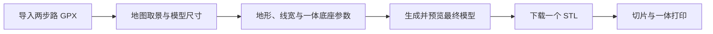

# 徒步路线 → 可打印三维地形：开发流程 v0.1（React＋一体 STL 修订版）

修订日期：2026-10-10。状态：阶段 1 已完成基础地形核心；阶段 2 已完成一体浮雕生成核心、示例 STL 与几何自查，详见 [阶段2-实现与验收.md](./阶段2-实现与验收.md)。目标切片软件和实物打印待验证。阶段 3 React 网页接入尚未开始。

上游参考：[baozjj/TrailPrint-3D](https://github.com/baozjj/TrailPrint-3D)，固定提交 `f8909baed1152d01b20eb76bc666ff20f457b38d`。源码事实见 [TrailPrint-3D-流程研究.md](./TrailPrint-3D-流程研究.md)。上一版方案保存在 [history/开发流程-v0.1-TrailPrint三件套版.md](./history/开发流程-v0.1-TrailPrint三件套版.md)。

## 1. 已确认的产品要求

本次以用户最新要求为准，替换此前的 Vue 网页和分件装配方案：

| 项目 | 本版确定方案 |
| --- | --- |
| 网页架构 | React＋TypeScript，直接接入《川衡网页设计》的现有 Vite／React Router 工程 |
| 打印交付 | 直接下载一个二进制 STL，例如 `路线名称_Terrain.stl` |
| 模型结构 | 山体、路线、一体底座／边框融合为一个连续闭合实体 |
| 路线表现 | 在 DEM 地表上直接形成高出地表 **1 mm** 的浮雕线 |
| 使用顺序 | 先个人验证，再向协会成员开放 |

“三合一”按山体、路线和底座一体成型理解。原托盘改为一体底座／边框，移除山体放置凹槽、装配公差和嵌件结构。用户不需要打印后拼装。

路线的 1 mm 指最终模型的突出高度；路线宽度是独立参数。首版高度固定为 1 mm，线宽可调整，初始试验值沿用上游的 1 mm，之后根据切片和实物效果收敛。

原项目提供可复用的高程、投影、地形和 STL 工具；一体浮雕路线及 React 界面是本项目需要实现的改造。

## 2. 成品与下载契约

默认下载只有一个 STL，不打包三个 STL，也不要求下载 ZIP。生成参数、数据来源和尺寸说明显示在网页结果页；如需要，可另外下载说明文件。

必须区分“一个文件”与“一个实体”：最终模型须消除重叠内部面及部件间间隙，并形成一个连通、闭合的实体。直接把三个旧网格拼到同一个 STL 中不满足要求。

模型采用毫米尺度导出，最低底面放到 `Z = 0`，方便切片软件放置。STL 不记录单位，结果页与文件说明明确标注毫米。页面显示山体范围、底座外轮廓及最终长×宽×高，以最终外尺寸检查打印平台能否容纳。

路线几何采用以下约定：

```text
zTerrain(x, y) = 完成采样、平滑、模型缩放及底座偏移后的地表高度（mm）
zRouteTop(x, y) = zTerrain(x, y) + 1.0 mm
```

首版按模型 Z 方向增加 1 mm；不是沿山坡法线量取 1 mm。此约定在生成参数中写明。路线在整个带宽范围内随地形起伏，不能只抬高中心线后让两侧悬空。

地形的垂直夸张、质量档高度压缩等处理全部先完成，再添加路线高度。此后若因打印平台高度需要改变缩放，应重新生成路线，保持实际突出高度为 1 mm。

预览可以用强调色帮助辨认路径；STL 本身不保存颜色。首版以浮雕几何突出路线，彩色外观可通过打印后的上色或切片软件处理。

## 3. 用户流程与自动生成流程



网页只暴露与一体模型有关的参数，去掉槽深、嵌件突出高度、路线槽公差、托盘装配公差等旧控件。

后台顺序：

```text
GPX 内容
  → XML 解析，保留多个轨迹段，清理无效点
  → 确定地理选区、旋转、地形轮廓与模型尺寸
  → 下载／缓存 DEM，裁剪采样并处理缺值
  → 地形平滑、相对高程与毫米缩放
  → 保存最终毫米地表，建立山体与一体底座
  → 轨迹投影到模型 XY，按地表重采样
  → 生成指定线宽的路线走廊，处理重叠和交叉
  → 将走廊地表提高 1 mm，连接过渡侧面
  → 构造统一外表面，闭合侧壁与平底
  → 检查连通性、网格质量、尺寸与实际路线高度
  → 写出一个二进制 STL
  → React 预览／结果页／直接下载
```

GPX 提供路线位置，DEM 提供山体高程；路线的打印高度按生成后的 DEM 地表计算。每次生成冻结轨迹、参数、数据源、选区及实际缩放；后台不能在未提示的情况下改变取景范围。

### 一体浮雕路线的实现优先级

优先改造高度场网格生成：把路线走廊边界纳入三角网格，在走廊内形成地表加 1 mm 的顶面，边界增加侧面；删除被替代的原地表面，一体底座与山体采用共享边界。路线加密应发生在需要的局部，不能依赖粗网格恰好覆盖细线。

路线走廊先处理自身交叉和往返重叠，再生成外表面。高度按走廊并集增加一次；交叉处仍高出地表 1 mm，不能叠成 2 mm。起终点收口，出界后重入保留多个有效段，不生成跨区虚构连线。

按路线边界重新划分受影响的地形三角面，不能只把命中的格点抬高。走廊算法需支持非凸形状、多段及闭合环路内孔；上游的凸多边形裁剪工具不能直接承担这些处理。

若直接构造统一网格在某些轮廓上遇到明确问题，可以验证网格布尔并集方案。参与布尔运算的浮雕体应向地形内有足够重叠，不能只贴在同一表面；融合后移除内部面并重新检查。算法选择由样品质量及性能决定，但用户输出契约始终是单一实体 STL。

## 4. TrailPrint 的模块复用与替换

| 上游模块 | 本项目处理 |
| --- | --- |
| DEM provider、GeoTIFF 采样、缺值处理、平滑 | 复用主要算法，移除 Electron 缓存路径，改为服务配置 |
| 地理选区、模型投影、旋转、轮廓工具 | 复用并验证边界及尺寸语义 |
| GPX 与轨迹投影／重采样 | 复用基础逻辑，修复轨迹分段和裁剪重入 |
| 高度场／地形实体生成 | 复用无槽山体逻辑，增加一体浮雕路线与底座构造 |
| `trail-groove`、`trail-groove-imprint` | 首版生成链停用，不挖路线槽 |
| 原 `trail-line-mesh` | 参考地表采样方法，替换为一体浮雕构造，不导出独立路线件 |
| 托盘轮廓／圆角工具 | 参考外形计算，底座改为一体结构，不沿用装配凹槽 |
| `stl-writer`、网格校验 | 复用 STL 写入，加强一体模型检查 |
| 原 `generateModelsZip` 导出入口 | 新建一体 STL 生成入口，保留有用工具，不沿用分件导出编排 |
| `zip-packager`、桌面保存对话框 | 从默认输出链移除，改为单 STL 下载 |
| Vue／Pinia／Vue 组件 | 参考操作行为，在 React 中重新实现控件、状态、地图和预览 |
| Electron IPC／全局最近 GPX 缓存 | 替换为 HTTP 任务接口和明确归属的轨迹资源 |

复用上游代码时保留其 MIT 许可及版权声明。上游源码快照作为参考保存，不将其中的文档状态直接当作我们的验收结果。

## 5. React 原生接入川衡

```text
川衡现有 React＋TypeScript＋Vite 工程
  /tools/terrain-print 页面（按需加载）
  GPX 导入／参数／地图／最终模型预览／下载
  现有导航、登录会话、设计样式
                    │
                    ▼
川衡 Node API 的任务接口
  任务创建／状态进度／预览资源／STL 下载
                    │
                    ▼
独立 Node 计算进程
  高程、投影、统一网格及 STL 生成核心
                    │
                    ▼
任务目录／DEM 缓存／单 STL／生成记录
```

直接在 `src/features/terrain-print/` 新增 React 功能模块，沿用当前 React Router、登录／网站状态上下文和 API 客户端。地图与三维渲染可使用上游所用的 Leaflet、Three 基础库，通过 React 组件生命周期管理；不引入 Vue、Pinia、独立 Vue 页面或 iframe。

参数、地图视口、轨迹资源及任务状态分别管理，避免每次地图移动都触发完整导出。现有网站的字体、色板、按钮与导航沿用 `DESIGN.md`，重型地图／三维模块按路由加载。

生成采用异步任务，不把耗时计算放在现有登录或报名接口的请求线程中。个人版先单并发子进程执行，浏览器创建任务后读取进度；计算完成再获取预览和 STL，避免受到普通 API 请求超时限制。现有 JSON API 客户端用于短请求；STL 二进制通过专门下载端点获取。

可先显示轻量地形预览辅助取景，最终确认预览必须来自待下载 STL 的同一份网格及冻结参数。旧请求响应丢弃之外，还需合并待执行预览、支持取消或替换任务，避免后台堆积。

每个任务显式携带轨迹资源或点列，取消上游全局“最近一次 GPX”回填。接入时使用现有会话和任务归属检查，下载接口也验证归属。

高程访问先沿用个人 OpenTopography Key，并放在服务配置中。成员开放前确定符合数据服务规则的访问方式及缓存策略。相关规则见 [OpenTopography 开发者说明](https://opentopography.org/developers)。

## 6. 首版参数范围

| 参数组 | 首版内容 |
| --- | --- |
| 取景 | 中心、缩放、旋转、圆形／矩形／正多边形及圆角 |
| 尺寸与底座 | 山体取景尺寸、一体底座厚度、边框样式与宽度，显示最终外尺寸 |
| 地形 | DEM 数据集、垂直夸张、网格精度、平滑 |
| 路线 | 轨迹简化、线宽；突出高度固定为 1 mm |
| 输出 | 单 STL、毫米说明、最终预览、生成记录 |

网格精度必须能保留所选线宽与转弯。高精度档先测量时间、内存和文件大小，再决定网站默认值。路线在地形平滑后生成，不能用后续平滑把浮雕线削弱。

首版移除装配、公差、磁吸、NFC、翻模与喷漆参数；3MF、STEP、文字等增强不影响当前单 STL 的实现顺序。

## 7. 逐轮开发顺序

| 阶段 | 我完成的工作 | 交付与通过条件 | 用户参与 |
| --- | --- | --- | --- |
| 0：修订流程 | 固定上游参考版本，调整 React、单 STL 和 1 mm 路线要求 | 本流程及复用边界；本轮完成 | 修改成品与优先级 |
| 1：无 Electron 生成核心 | 按模块验证 DEM／投影／地形，提取 Node 生成入口，修复 GPX 分段 | 已完成示例＋真实 DEM 的闭合无槽地形 STL，见阶段 1 记录 | 真实两步路 GPX 待提供，之后确认构图 |
| 2：一体模型样品 | 实现浮雕路线、一体底座、统一网格及质量检查 | 已生成一个 STL、单一闭合实体，路线高出地表 1 mm；边界与抽样截面检查通过 | 确认线宽、外形、尺寸；切片及实物仍待验收 |
| 3：React 网页接入 | 在川衡新增工具路由、参数、地图、预览、任务接口及直接下载 | 从川衡完成上传 → 取景 → 预览 → 一个 STL 下载 | 用另一条路线完整操作 |
| 4：个人打印验证 | 验证陡坡、回环、分段及性能，完成实物小样，调整默认参数 | 路线清晰、底座稳定、无虚构连线，切片和实物符合预览 | 打印或代打、反馈成品 |
| 5：成员开放 | 增加任务持久化、恢复、资源限额、保留期限与正式数据源方案 | 成员任务隔离，生成与下载可恢复，服务负载受控 | 确认开放对象和额度 |
| 6：增强 | 按需求增加 3MF、STEP、文字或更多外形／数据源 | 每项独立验收，单 STL 功能继续保留 | 选择下一项增强 |

不以完整复现原三件套桌面程序作为开工门槛。上游的有关模块测试和样例用于核对数据与几何；不投入实现已被替换的分件装配或 Vue 网页阶段。

先验证一体生成核心再搭建完整交互，避免网页做好后才发现路线几何不可打印。只有发生相关改动或检查失败时才补充、重跑对应验证。

## 8. 首版验收

- 正常操作直接下载一个 `.stl`，不需要解压或手工合并部件。
- 山体、路线与底座形成一个连通闭合实体；没有悬浮路线、部件间隙及重叠内部面。
- 路线沿最终 DEM 地表，常规段、交叉与往返段实际 Z 高差均为 1 mm，在规定网格误差内验证。
- 线宽在模型毫米尺度定义；低精度、急转弯和陡坡样例中路线仍连续可辨。
- GPX 多段及取景出界重入没有虚构连线；裁剪端点闭合。
- 顶点和索引有效，退化面、开放／非流形边、法线和体积检查通过；重点样例另查自交与切片截面。
- 底面为 Z=0；底座有明确实体厚度；结果页显示最终外尺寸和数据处理记录。
- 最终预览和下载使用同一份网格；改变地形缩放后仍重新保持路线突出 1 mm。
- STL 在目标切片软件中作为一体模型打开，无需人工修补；实际打印样品验证路线可见与底座稳定。
- 工具采用 React 原生路由和组件，登录与现有网站功能正常；任务失败、取消与下载状态明确。

阶段 1 使用上游示例 GPX 完成核心验收。用户真实 GPX 待提供，并在后续样品验证时确定打印机／代打方式、切片软件和目标尺寸。

建议下一轮指令：

> 确认阶段 2 样品后，进入阶段 3：在川衡现有 React 工程中实现网页上传、取景、预览、异步生成与一个 STL 下载。生成核心放入独立计算进程，沿用现有网站设计与登录状态。
