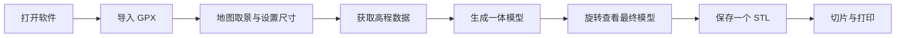

# 徒步路线 → 可打印三维地形：开发流程 v0.2（独立桌面软件）

修订日期：2026-10-10。本版依据用户要求：将工具作为独立软件制作。阶段 1、2 已完成的高程、投影和一体建模核心继续使用；网站接入工作已停止。阶段 3.2 的地图取景与系统保存闭环已经通过。当前 Windows **0.3.3 个人验证版可用，已完成的原生操作验收通过，文件拖入待人工验收**；59 项桌面测试通过，第三阶段整体尚未关闭。

阶段 2 已获用户确认。现有样品、155 项通过的测试和几何验收见 [阶段2-实现与验收.md](./阶段2-实现与验收.md)。目标切片软件与实物打印尚待验证。旧网页方案已归档到 [history/开发流程-v0.1-React网页一体STL版.md](./history/开发流程-v0.1-React网页一体STL版.md)。

## 1. 产品目标

用户在自己的电脑上打开软件，导入两步路或类似软件导出的 GPX，选择模型取景与参数，生成三维地形，最终把一个可打印 STL 保存到指定文件夹。

| 项目 | 本版方案 |
| --- | --- |
| 运行形式 | 独立桌面软件，直接打开应用窗口 |
| 首版平台 | 当前 0.3.3 为 Windows 64 位；其他系统后续适配 |
| 软件框架 | Electron＋React＋TypeScript；复用已有 Node 生成核心 |
| 最终打印文件 | 一个二进制 STL，毫米尺度 |
| 模型结构 | 山体、浮雕路线、一体底座／外沿，形成一个连续闭合实体 |
| 路线高度 | 整个路线带按模型 Z 方向高出最终 DEM 地表 1 mm |
| 首版线宽 | 默认 1 mm，宽度与突出高度独立设置 |
| 使用顺序 | 先个人验证，再向成员分发软件 |

当前构建采用 Windows 64 位。React 继续作为软件界面框架，已有生成核心在独立计算进程中复用。

## 2. 用户操作流程



具体行为：

1. 通过“导入路线”或拖入 GPX 打开路线，显示名称、长度、点数和轨迹段。
2. 自动给出覆盖路线的取景，允许移动中心、调整地面范围、旋转和选择成品外形。
3. 设置山体尺寸、线宽、底厚、外沿、垂直夸张和精度，明确显示路线固定突出 1 mm。
4. 软件获取对应区域高程；已缓存数据可复用，也可选择本地 DEM。
5. 点击“生成模型”，显示实际进度，并可取消。
6. 用三维预览查看最终网格，可旋转、缩放、俯视或恢复视角；显示成品外尺寸。
7. 点击“保存 STL”，通过系统保存窗口选择位置，写出一个打印文件。

更改参数后，旧模型标记为“此前结果”，重新生成后才能作为当前参数结果保存。每次任务冻结 GPX、取景、参数和高程来源，预览与保存对应同一次生成。

再次打开软件时恢复有效模型偏好、高程来源与仅缓存设置；点击“恢复上次项目”才读取最近路线与本地高程文件，并恢复项目取景。文件缺失、内容改变或无效时明确提示重新选择；可用参数继续保留。恢复不自动生成、不恢复旧预览或旧 STL。地图底图开关不持久化。

## 3. 软件结构

```text
独立桌面窗口：React＋TypeScript
  路线导入／地图取景／参数／三维预览／进度
                         │
                  受控的应用通信
                         ▼
Electron 主进程
  文件选择／保存／设置／缓存目录／任务管理
                         │
                         ▼
独立计算进程
  DEM 获取与处理 → 已验收的一体模型核心 → 网格检查
                         │
                         ▼
最终网格＋本地任务记录 → 系统保存窗口 → 一个 STL
```

Electron 可使用 Node 环境并管理独立计算进程，适合承接现有核心；地图和三维界面继续使用 React。耗时计算优先放到 `utilityProcess`，避免阻塞应用窗口。[Electron 进程模型](https://www.electronjs.org/docs/latest/tutorial/process-model)、[utilityProcess](https://www.electronjs.org/docs/latest/api/utility-process)。

界面通过限定的预加载桥接调用文件和任务操作，文件系统与密钥由主进程管理；界面加载打包的本地资源。地图服务内容不获得本地文件权限。[Electron 上下文与安全建议](https://www.electronjs.org/docs/latest/tutorial/security)。

现有核心的开发环境要求 Node 24。当前桌面包锁定 Electron 44.7.0，实际包内运行时为 Node 24.21.0；独立计算进程、核心依赖、任务取消与保存逻辑已经由实际 exe 检查。最终用户使用完整软件文件夹，不需要自行安装 Node 或运行开发命令。

软件代码、构建配置和验收文件放在“徒步路线打印自动化”项目中。生成核心保持独立；桌面窗口、主进程和计算进程分层，便于后续维护。

## 4. 高程获取与离线使用

| 数据方式 | 规划用途 | 完成条件 |
| --- | --- | --- |
| 公开 Copernicus GLO-30 | 0.3.2 界面的默认自动高程入口，无需个人 Key | provider 真实龙泉山／德国跨瓦片检查、打包版 Mojstrovka 自动生成与缓存，以及实际地图和保存闭环已通过 |
| OpenTopography | 生成核心的备选接口，当前桌面界面不提供入口 | 核心可使用用户本机个人 Key；桌面接入另行安排 |
| 本地 GeoTIFF | 离线入口及自备 DEM／DTM 数据 | 保留现有支持范围及明确校验错误 |
| 示例 GPX＋已验收 DEM | 首次体验和桌面闭环验证 | 随应用提供可复现示例，清楚标记示例路线 |

首次获取未缓存区域的在线高程、加载在线底图需要联网。已有高程缓存或本地 DEM 可用于离线建模；在线底图不可用时仍显示路线和取景轮廓，保留导出能力。高程缓存按精确的地理取景窗口保存，不下载整张 DEM 瓦片；“仅使用已缓存高程”缺少该窗口时明确报错。移动中心、旋转、改变地面范围或尺寸比例后可能需联网重新获取，不能把相邻窗口自动视为已有覆盖。

Copernicus 入口已实现公共 COG 选区读取、跨瓦片采样、校验缓存及明确错误。真实联网检查覆盖龙泉山，以及德国 49°／50° 纬度与 9° 经度交界的四瓦片区域，后者包含 3600／2400 列的不同分辨率。南／西半球、缺值、无覆盖等情况由确定性测试覆盖，尚不能视为这些地区全部经过真实联网验证。所用公共数据为 DSM，包含植被和建筑等地表对象；软件显示来源及性质。具体证据见 [阶段3.2-实现与验收.md](./阶段3.2-实现与验收.md)。[Copernicus 数据说明](https://registry.opendata.aws/copernicus-dem/)。

遇到未覆盖区域、网络错误或过多缺值时，显示原因并提供重试、缩小取景或选择本地 DEM 的操作。默认数据源的可用性和下载性能在第三阶段实测确定。

## 5. 一体模型契约

模型保持阶段 2 已验收的行为：

```text
路线顶面(x, y) = 完成地形处理后的地表高度(x, y) + 1.0 mm
```

- 1 mm 是最终模型 Z 方向的高差；路线整个带宽随地形起伏。
- 路线交叉和往返覆盖区先取并集，只抬高一次；回环中间保留普通地形。
- GPX 多段和出界重入保持真实分段，不补虚构连线。
- 山体、路线和一体底座构造统一外表面，底面 Z=0。
- 默认只保存一个 STL。生成报告与诊断资源留在应用任务目录，需要时可另行导出。
- 显示含外沿的实际成品长、宽、高；STL 本身没有单位和颜色，界面标注按毫米解释，路线强调色仅用于预览。

## 6. 首版界面与参数

界面以完成建模任务为主：左侧为路线与参数，右侧为“地图取景／三维模型”工作区，底部显示任务进度和保存操作。常用参数直接可见，复杂参数放在“更多设置”。

| 参数 | 首版默认／范围 |
| --- | --- |
| 外形 | 矩形；支持圆形、3–8 边正多边形及适用圆角 |
| 山体尺寸 | 默认 120 × 80 mm，现有核心范围 10–500 mm；圆形／多边形按外接圆直径定义 |
| 取景 | 自动覆盖路线，可调整中心、地面宽度、旋转和留白 |
| 底厚 | 默认 2 mm，0.5–30 mm |
| 外沿宽 | 默认 3 mm，0–20 mm；0 关闭外沿 |
| 路线宽 | 默认 1 mm，0.4–5 mm |
| 路线突出高度 | 固定 1 mm |
| 垂直夸张 | 默认 2；更改后重新生成浮雕 |
| 精度 | 已提供 65／129／257 点档，默认 129；复杂组合仍受核心预算限制 |
| 平滑 | 原始、轻度、中度、重度 |
| 高程来源 | 显示来源、覆盖状态、缓存状态及实际处理记录 |

核心保留 50 万三角面上限和明确参数校验。更高档位需先测量文件大小、时间与内存，不能让界面承诺核心无法完成的组合。

## 7. 文件、任务与设置

- 路线通过系统文件选择或拖入读取。任务明确使用当前轨迹，切换文件时清理上一次参数归属和临时状态。
- 首版单任务计算；重复点击不重复启动。修改参数不会自动堆积完整生成任务。
- 取消会终止该计算进程，结束下载并清理临时资源；之后可以重新生成。应用退出时正确结束任务。
- 进度按实际阶段反馈，只有最终一体网格检查通过才显示完成；失败不覆盖原有已保存模型。
- 模型先生成到应用任务目录，再通过保存窗口导出。保存位置取消、磁盘写入失败、中文路径和已有文件覆盖都需明确处理。
- 缓存、设置和任务文件使用系统用户数据目录，避免向安装目录写入。缓存有位置说明和清理操作。
- 3.3 已实现模型偏好与最近项目恢复。启动仅恢复非地理模型参数、高程来源与仅缓存设置；用户主动恢复项目后才载入路线／本地 DEM 及其取景中心和地面范围。恢复文件复验内容指纹与格式；异常时提示，保留有效偏好。
- 设置由主进程在系统用户数据目录串行、原子保存；界面只提交已导入的文件 ID。关闭等待已收到的保存请求完成。底图开关、旧任务／预览与旧 STL 不持久化；恢复后需重新生成。批量生成、自动更新与复杂项目管理留到后续。

## 8. 修订后的开发阶段

| 阶段 | 我完成的工作 | 交付与通过条件 | 用户参与 |
| --- | --- | --- | --- |
| 0：本轮修订 | 固定独立软件方向、保留单实体 STL 契约 | 本流程 v0.2；本轮完成 | 修改平台、功能或优先级 |
| 1：基础生成核心 | GPX、DEM、投影、地形实体与导出 | 已完成；原阶段 1 成果保留 | 已确认建模外观 |
| 2：一体模型核心 | 路线浮雕、底座、统一网格和检查 | 已完成并获用户确认；155 项测试通过 | 切片与实物可在后续验证 |
| 3：独立桌面软件 | 软件窗口、地图、参数、自动高程、最终预览、任务和本地保存 | 3.2 通过；0.3.3 的 59 项测试与已完成原生操作通过，文件拖入待人工，第三阶段尚未整体完成 | 用自己的 GPX 操作，并完成人工拖入检查 |
| 4：个人打印验证 | 检查实际路线、陡坡、回环、性能与实物，调整默认值 | 切片和打印符合预览，路径清晰、底座稳定 | 打印或代打，反馈线宽和尺寸 |
| 5：软件打包与成员试用 | Windows 发布包、许可说明、干净环境验证和使用说明 | 无开发环境的电脑也能打开、生成及保存 | 在另一台电脑试用，再分发给成员 |
| 6：增强 | 按需求增加 3MF、STEP、文字、批量、多平台或更新机制 | 每项独立验收，一体 STL 功能持续保留 | 选择下一项增强 |

### 第三阶段的执行顺序

**3.1 桌面闭环。** 已交付 0.3.1 可启动构建，真实打包计算、生成／取消后重试及单 STL 保存的自动检查通过。Electron＋React 窗口已接入 GPX／本地 DEM、参数、最终模型预览、进度与保存；当时未完成的原生导入／保存基础操作，已在 3.2 的完整界面验收中补齐。

**3.2 自动高程与地图取景。已完成。** 非示例 Mojstrovka GPX 已经原生窗口实际导入，验证地图点选／拖动中心、1.5 km 地面范围、20° 旋转、显示全貌、地图平移／缩放保持模型参数、恢复自动取景及底图开关，最终包可显示完整在线 OSM 底图。实际查看三维网格，验证旧结果禁用保存、仅缓存成功与未缓存错误；系统保存实际验证取消、中文加空格路径、自动补后缀及拒绝／同意覆盖。GUI 在线、缓存、预览与保存一致，结果为一个闭合实体 STL。189 项核心测试已有通过，本轮 45 项桌面测试全部通过、零跳过，含 3 个真实 Windows junction 用例。先前打包运行时的任务取消后重试检查继续成立；GUI 长任务取消保留到 3.3，不将未赶在任务完成前的尝试记为通过。具体数据及修复记录见 [阶段3.2-实现与验收.md](./阶段3.2-实现与验收.md)。

**3.3 桌面使用验收。原生操作已完成大部分，拖入待人工。** 已增加有效参数保存与用户主动恢复最近项目，59 项桌面测试全部通过、零跳过；189 项核心测试沿用既有通过结果，核心未改。实际系统选择中文空格 GPX／DEM、单 STL 保存、重启恢复项目与手动中心、缺失路线提示、无效 GPX 不替换有效输入、最小窗口及 100%／125%／150% 应用显示缩放均已验证。实际长任务运行中取消后可成功重试，计算中退出后进程与临时任务均清理。取消提示的状态优先级已修复并重新打包，最终回归和修改参数立即退出检查正在收尾。原生跨窗口拖入受当前工具控制范围限制，GPX／DEM、各一份同时拖入及不支持文件拖入反馈均需人工验证，因此尚不关闭 3.3 或第三阶段。独立核查的少量极小面法线差异列入阶段 4 切片重点检查。证据见 [阶段3.3-实现与验收.md](./阶段3.3-实现与验收.md)。

每个小步骤先做可运行版本，再让用户目视与操作反馈；只有第三阶段全部步骤通过，才标记桌面软件阶段完成。

## 9. 验收清单

1. 独立打开桌面窗口即可操作；正式发布版无需安装开发工具或手动启动服务。
2. 导入真实 GPX 后，轨迹、分段、取景及地形来源正确。
3. 自动高程覆盖一般使用流程；缓存或本地 DEM 支持离线生成。
4. 三维预览来自最终保存网格，尺寸与任务参数一致。
5. 一个 STL 中形成一个闭合连续实体，保持阶段 2 的高度、拓扑、体积和 Float32 检查。
6. 路线在最终模型上突出 1 mm，交叉／往返只抬高一次；更改地形缩放后仍满足要求。
7. 生成时窗口可操作，取消、错误和重新生成状态清楚。
8. 能选择位置保存，中文路径与已有文件处理正常，失败不会损坏旧结果。
9. 安装／发布后的计算进程、依赖、示例与资源路径均有效，并在干净环境复验。
10. 目标切片软件和实际打印验证单独记录；代码检查和预览不能替代实物验收。

## 10. 下一轮工作入口

> 使用 `desktop/release/v0.3.3/TerrainWorkshop-win32-x64/` 完成人工跨窗口拖入 GPX／DEM、各一份同时拖入及不支持文件反馈检查。59 项桌面测试与已完成的系统导入／保存、恢复、缩放、取消和退出操作通过；最终提示修复与快速退出恢复正在收尾。拖入通过前不关闭第三阶段。阶段 4 切片／实物需关注极小面法线差异，阶段 5 干净电脑与成员分发留到后续。
